# Proposal: Google TV-style Home, settings redesign, effects and wallpapers

**Status:** draft for review · **TV:** Sony BRAVIA KD-49X8500H (4K UR3, Android TV 9) · **Base:** launcher v19 (`main` at `0c5f3e3`)

All images are **mockups** (drawn in HTML), not screenshots from the TV. App tiles are shown as coloured name
blocks; the real launcher shows each app's own banner.

---

## 1. Summary

| # | Area | What changes | Phase |
|---|---|---|---|
| 1 | Settings | Two-panel Launcher settings; multiple-choice options open their own page with previews | 0 |
| 2 | Wallpaper quality | Full-colour decoding + higher-quality wallpapers (fixes the "pixelated" look on 4K) | 0 |
| 3 | Google TV layout | New Home: tabs, banner, rows, Apps tab, Inputs tab; Apple TV layout kept as fallback | 1–2 |
| 4 | Continue watching | Test row from apps' "watch next" data; hides itself if the TV blocks it | 3 |
| 5 | Effects | Glow, focus styles, focus extras, background motion, transitions, dim when idle | 5 |
| 6 | Wallpaper sets | Gradients, Thailand, Seasonal, Space, Abstract, Solid; time of day; blur; online daily pictures (opt-in) and a PC download script | 6 |
| 7 | Polish | Remote navigation on every edge, Hebrew strings (CI), README | 4 |

**Decisions already made**

| Topic | Decision |
|---|---|
| Focus | Google TV layout first; Apple TV layout stays as a fallback option |
| Choices | Every layout choice is a Launcher setting (nothing hard-wired) |
| Settings style | Two panels (left menu, right page) |
| Multiple-choice options | Open a **separate page**; picking keeps the page open; **Back returns to the same row** |
| Glow | Ambient glow On/Off and Glow style merge into one **Glow** choice with **Off** first |

---

## 2. Google TV layout

### 2.1 Home screen

| Mockup | Description |
|---|---|
| A (below) | Tabs (Home · Apps · Inputs), banner with the selected app's name and colour glow, Open / Move in dock / App info, rows: Your apps, Inputs |
| C (below) | Same, banner over a wallpaper, plus a "Continue watching" row (only if the TV allows it) |

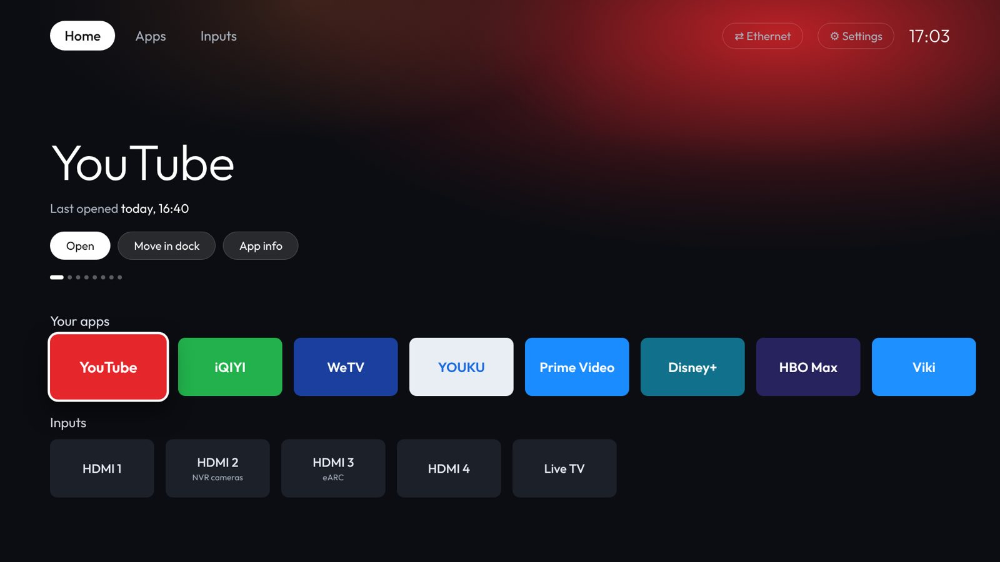

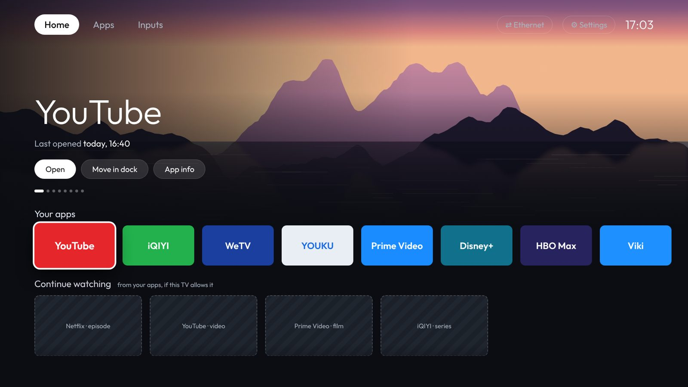

### 2.2 Apps tab

Every installed app, grouped (Streaming · Tools · Inputs).

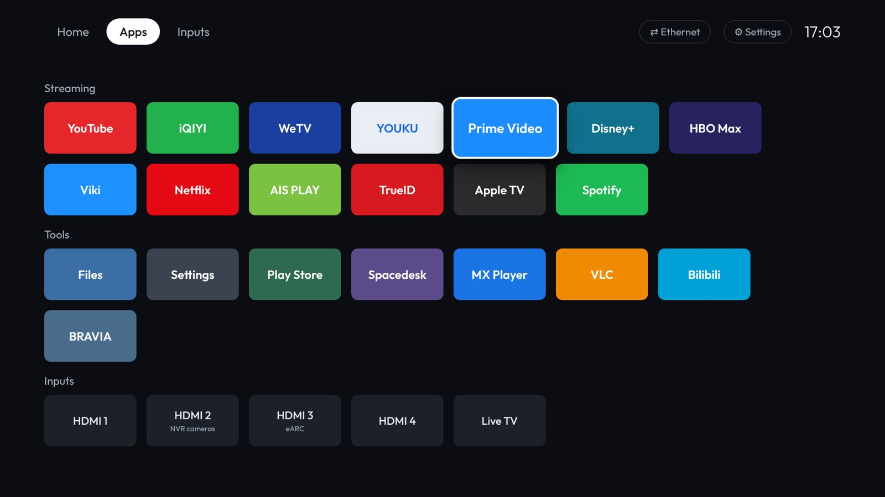

### 2.3 Layout styles (all selectable in settings)

| # | Style | Notes |
|---|---|---|
| 1 | Tabs + banner | Closest to Google TV; **default** |
| 2 | Side rail | Menu on the left instead of tabs |
| 3 | Posters | Tall, large tiles; fewer apps per row |
| 4 | Minimal | Big clock, one row of apps |

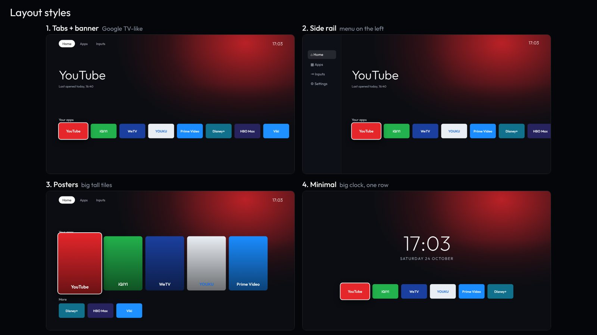

### 2.4 Settings for the Google TV layout

| Setting | Options | Default |
|---|---|---|
| Layout | Google TV · Apple TV | Google TV |
| Navigation | Top tabs · Side rail | Top tabs |
| Layout style (Home) | Tabs + banner · Posters · Minimal | Tabs + banner |
| Banner | App name + glow · Wallpaper · Off | App name + glow |
| Row: Your apps | On / Off | On |
| Row: Inputs | On / Off | On |
| Row: Other apps | On / Off | On |
| Row: Continue watching | On / Off (greyed "Not available on this TV" if blocked) | On |
| Apps per row | 5 · 6 · 7 · 8 | 8 |

### 2.5 How it is built

| Item | Approach |
|---|---|
| New screen | `GtvActivity`, separate from the current Home (`MainActivity`) so the Apple TV layout cannot break |
| Home button | Still opens `MainActivity`; when Layout = Google TV it immediately opens `GtvActivity` (the TV's default-home setting never changes) |
| Reused | App list and dock order, `LastOpened`, input list and "open input", glow painting and styles, wallpapers, fonts, hold-OK menu, settings-change rebuild |
| Rows | Vertical list of rows, each a horizontal list of tiles |
| Size | about +40 KB |

### 2.6 Continue watching (risk)

| Question | Answer |
|---|---|
| Source | `TvContract.WatchNextPrograms` (what apps publish for the Google home screen) |
| Permission | `READ_EPG_DATA`; may be refused to non-system apps on Android 9 |
| If refused | Row hides itself; setting shows "Not available on this TV" |
| Confidence | Low: needs a test on the TV (Phase 3) |

---

## 3. Launcher settings redesign

### 3.1 Structure

```
Launcher                                   (left menu)
├ Layout      Layout · Navigation · Layout style · Banner · Apps per row · Rows below dock*
├ Home rows   Your apps · Inputs · Other apps · Continue watching
├ Look        Wallpaper › · Cinematic home* · Font › · Clock style
├ Effects     Glow › · Focus style › · Focus extra › · Background motion › · Transitions › · Animations · Advanced effects · Dim when idle ›
├ Extras      Clock screensaver › · Input preview · App names under tiles · Edit dock · Reorder apps
└ TV settings Default home · TV settings
              * Apple TV layout only
  ›  opens a choice page
```

### 3.2 Navigation rules

| Action | Result |
|---|---|
| OK on an on/off row | Toggles it in place |
| OK on a row with › | Opens its choice page (list with preview + one-line description, current one ticked) |
| OK on a choice | Applies it; tick moves; **page stays open** |
| Back on a choice page | Returns to the section page with **that row focused** |
| Back on a section page | Returns to the left menu |
| Back on the left menu | Leaves settings; Home rebuilds |

### 3.3 Mockups

Two-panel: Layout section (short choices as buttons)

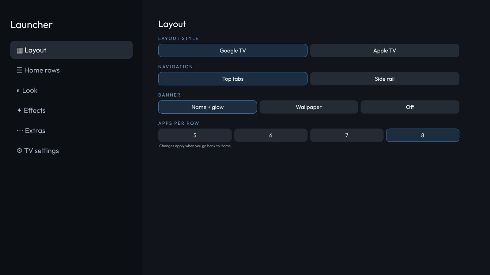

Two-panel: Effects section

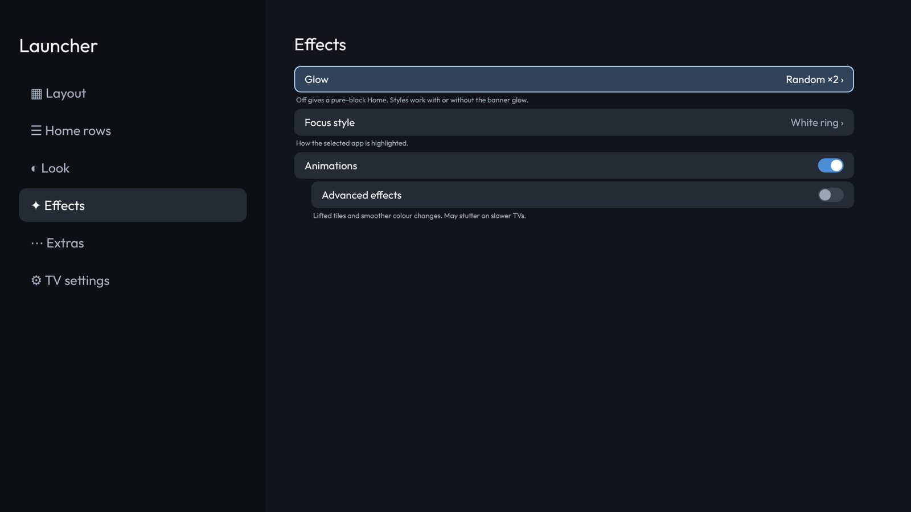

Choice page (Glow), with previews

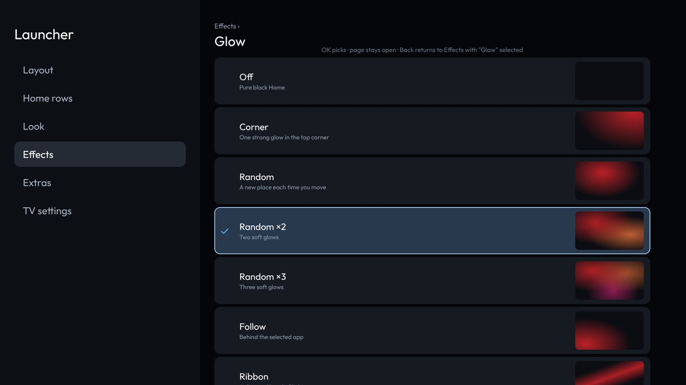

For comparison: the one-list style (not chosen)

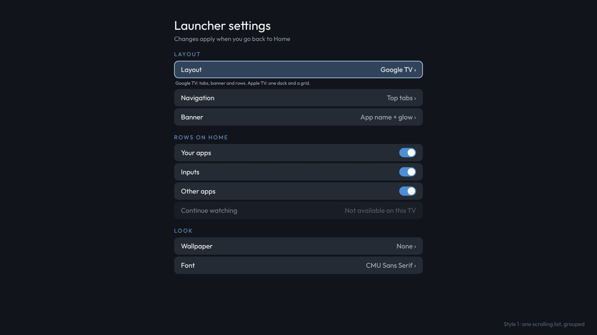

---

## 4. Effects

### 4.1 Glow

| Option | Description | Exists today |
|---|---|---|
| Off | Pure black Home | Yes (Ambient glow Off) |
| Corner | One strong glow in the top corner | Yes (Classic) |
| Random | A new place each time you move | Yes |
| Random ×2 / ×3 | Two or three soft glows | Yes |
| Fixed per app | Each app always gets its own spot | Yes |
| Follow | Glow behind the selected app | Yes |
| Slow drift | Moves slowly by itself | Yes |
| Random position and shape | Random size and stretch | Yes |
| Two glows | Second glow on the opposite side | Yes |
| **Ribbon** | Diagonal band of light | **New** |

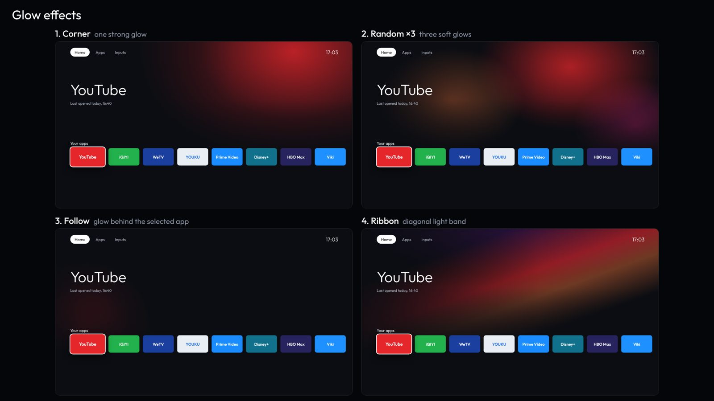

### 4.2 Focus style (selected app)

| Option | Description | Exists today |
|---|---|---|
| White ring | Current style | Yes |
| Lift | Rises with a shadow | New |
| Glass halo | Glow in the app's own colour | New |
| Underline | Small bar under the tile | New |

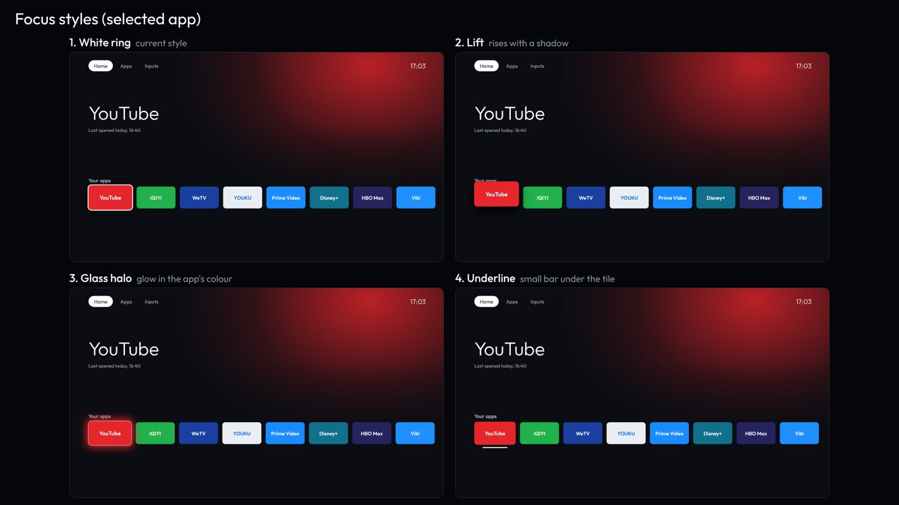

### 4.3 More effects

| Group | Option | Description | Load on this TV |
|---|---|---|---|
| Focus extra | Shine sweep | Light reflection slides across the tile | Low |
| Focus extra | 3D tilt | Tile leans toward the direction you moved | Low |
| Focus extra | Breathing | Selected tile gently pulses | Low |
| Transition | App-open zoom | Tile grows to fill the screen as the app opens | Low–medium |
| Transition | Banner fade / slide | Banner changes smoothly between apps | Low |
| Background motion | Parallax | Wallpaper shifts slightly as you move | Low |
| Background motion | Ken Burns | Slow zoom and pan | Low–medium |
| Background motion | Particles | Floating dust or stars | **Medium (runs all the time)** |
| Background motion | Aurora waves | Moving colour bands | **Medium (runs all the time)** |
| Idle | Dim when idle | Home dims after X minutes | Very low |

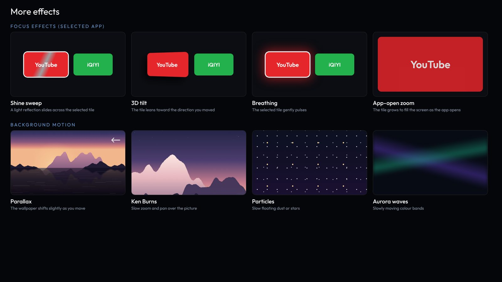

---

## 5. Backgrounds and wallpapers

### 5.1 Background types

| # | Type | Notes |
|---|---|---|
| 1 | Colour glow | From the selected app (today's default) |
| 2 | Wallpaper | Single picture or a rotating set |
| 3 | Sky | Changes with the time of day (`sky_intensity` exists) |
| 4 | Blurred colours | Soft mix of your dock apps' colours |
| 5 | Frosted glass (idea from `cookedzera/aura-tv`) | Wallpaper with blurred-glass panels |

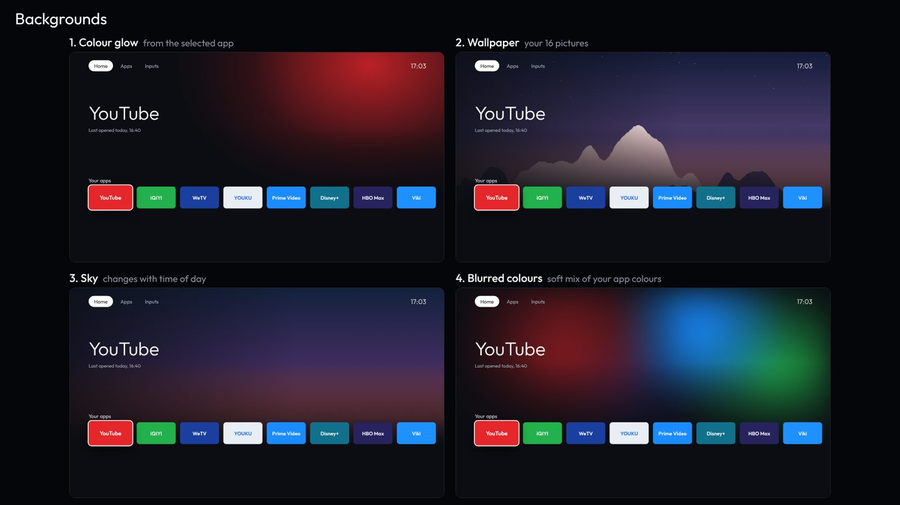

### 5.2 Quality fix ("pixelated on 4K")

| Cause | Detail | Fix | Phase |
|---|---|---|---|
| 16-bit colour | Wallpapers decode as `RGB_565`; `wallpaper_true_color` is off | Setting **Look › Wallpaper › Quality: Standard / High** (High = 32-bit, about +4 MB memory) | 0 |
| Strong JPEG compression | Scenes are 45–60 KB, quality 86 | Re-render the 14 scenes from `tools/scenes_wallpapers.py` at quality 95 (300–600 KB each) | 0 |
| 1080p pictures | Scaled 2× on a 4K panel | Only helps if the home screen renders at 4K: check `adb shell wm size` (likely `1920x1080`) | 0 (check) |

### 5.3 New wallpaper sets (samples, all offline)

| Set | Content | How made |
|---|---|---|
| Gradients | Smooth blends (midnight, sunset, mint) | Code |
| Solid | Black, charcoal, navy, deep green | Code |
| Abstract | Blurred shapes, waves, grain | Code |
| Thailand | Temples at dusk, rice terraces, Bangkok night, Andaman coast | Code (drawn) |
| Seasonal | Songkran, Loy Krathong, New Year; switch by date | Code (drawn) |
| Space | Night sky, Milky Way, moon | Code |
| My pictures | Your own photos | ADB push (works now); USB stick (new) |

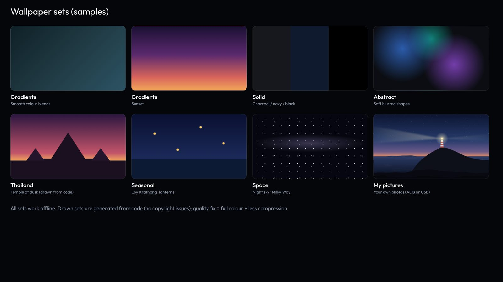

### 5.4 Wallpaper page (Look › Wallpaper)

| Setting | Options |
|---|---|
| Picture | None · single picture · whole set |
| Set | Scenes · Gradients · Solid · Abstract · Thailand · Seasonal · Space · My pictures |
| Change every | Off · 15 min · 1 h · 6 h · daily |
| Order | Shuffle · In order |
| By time of day | On / Off (morning / day / evening / night pictures) |
| Dim | 0 · 20 · 40 · 60 % |
| Blur | Off · Soft · Strong |
| Quality | Standard · High |

### 5.5 Online and Google wallpapers

**Sources**

| Source | What it is | Licence (to verify before adding anything to the repo) | Use |
|---|---|---|---|
| Google Ambient mode / Backdrop (`com.google.android.backdrop`, installed on this TV) | Google's photo and art screensaver | Google's | As the TV screensaver only; no way for other apps to use its pictures |
| Google Earth View | About 2,600 satellite landscapes, offered free as wallpapers | Google and data providers; personal use | Download for personal use; never committed to the repo |
| Google Arts & Culture | Famous artworks | Each museum's; no public API | Not used |
| Pixel wallpapers | Google phone wallpapers | Google's; no redistribution | Not used |
| Wikimedia Commons Picture of the Day | Daily high-quality photo, often 4K | CC / public domain (per image) | Recommended daily source |
| NASA Astronomy Picture of the Day | Daily space photo | Mostly public domain | Optional daily source |
| Unsplash | Large free photo library | Unsplash licence; needs a free API key | Optional |
| Bing daily image (Microsoft) | Daily photo | Microsoft's; personal use | Optional |

**Three ways, all included**

| Option | How it works | Internet | Launcher stays offline | Phase |
|---|---|---|---|---|
| **A. Online wallpapers in the launcher** | Setting **Look › Wallpaper › Online: Off · Wikimedia daily · NASA daily · Earth View · Bing daily**; downloads one picture a day (only while Home is idle, Wi-Fi/Ethernet), caches the last 7, falls back to the offline set when there is no connection | Yes | **No**: adds the `INTERNET` permission, **Off by default**; the app's audit result "no network" changes | 6 |
| **B. PC download script** | `tools/wallpapers_online.py` (+ `.ps1`): downloads today's / a chosen number of pictures from the sources above at full quality, writes credits, pushes them with ADB into the launcher's `wallpapers/` folder | On the PC only | Yes | 6 |
| **C. Google's own screensaver** | TV Settings › Device Preferences › Screen saver › Backdrop / Ambient mode; the launcher's Clock screensaver stays Off | Yes (Google) | Yes (no change) | Now, no code |

**Wallpaper page additions (Look › Wallpaper)**

| Setting | Options | Notes |
|---|---|---|
| Online | Off · Wikimedia daily · NASA daily · Earth View · Bing daily | Option A; Off by default |
| Keep | 1 · 7 · 30 pictures | Cache size on the TV |
| Credit | On / Off | Small photographer / source line in a corner (required by some licences) |

---

## 6. Ideas from other launchers (GitHub topic `android-tv-launcher`)

| Idea | From | Verdict |
|---|---|---|
| Frosted glass over photos | `cookedzera/aura-tv` | Add as background type 5 |
| Glowing home | `yashoncode/konnect-tv` | Already covered by Glow |
| Quiet home (apps, inputs, photo, time) | `mdrzn/cleanframe-tv` | Covered by Minimal layout |
| Neon / sci-fi HUD | `glidiandev/kido`, `home-deck` | Optional future theme |
| Home guard (keep Home from being taken over) | `vgscity/vgs-cleantv` | Possible extra |
| IP-camera tile | `smartago/plui-tv-launcher` | Needs network: **not recommended** (launcher is offline by design) |

Only listings were read, not code; most of these repos are small and new.

The images below are **our own mockups of each idea applied to this launcher**, not screenshots of those
projects. Each sheet shows 4 variants; the single images are in [`ideas/`](ideas/) (e.g. `glass-1.jpg`).

### 6.1 Frosted glass

| # | Variant |
|---|---|
| 1 | Glass banner panel over the wallpaper |
| 2 | Glass tiles, app colour as a thin bar |
| 3 | Glass tab bar and status pill |
| 4 | Strong blur, minimal: clock and one glass dock |

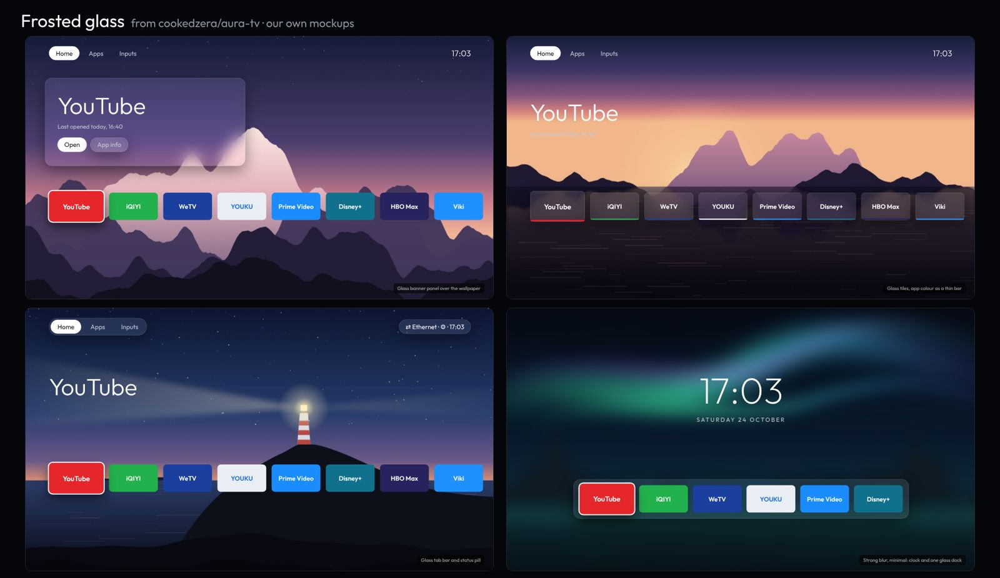

### 6.2 Glowing home

| # | Variant |
|---|---|
| 1 | Neon edge glow round the dock, in the app's colour |
| 2 | Coloured light under each tile, like a reflection |
| 3 | Light pulsing behind the banner title |
| 4 | Whole-screen colour wash that blends to the next app |

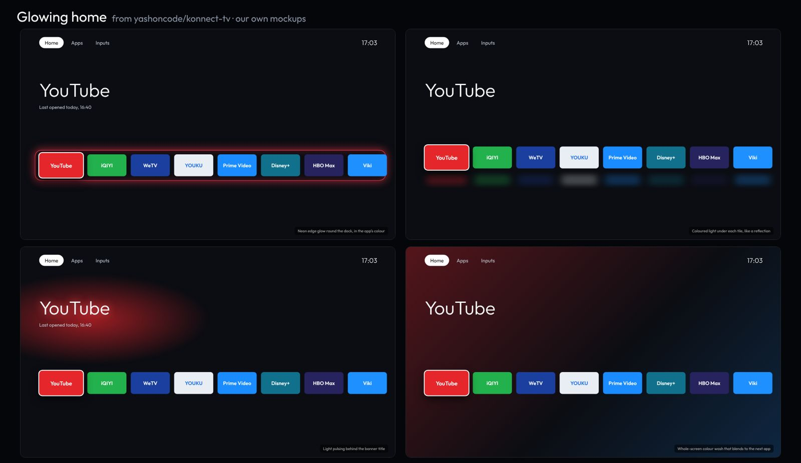

### 6.3 Quiet home

| # | Variant |
|---|---|
| 1 | Photo, time and one row of apps |
| 2 | Photo with inputs only (a TV-first home) |
| 3 | Time and four big tiles, nothing else |
| 4 | Dark, text-only list |

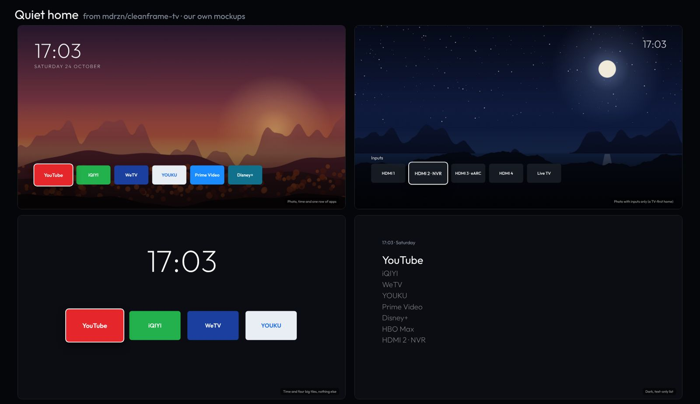

### 6.4 Neon / sci-fi HUD

| # | Variant |
|---|---|
| 1 | Cyan HUD frame and grid |
| 2 | Purple synthwave sun and grid |
| 3 | Terminal / monospace style |
| 4 | Circular HUD clock |

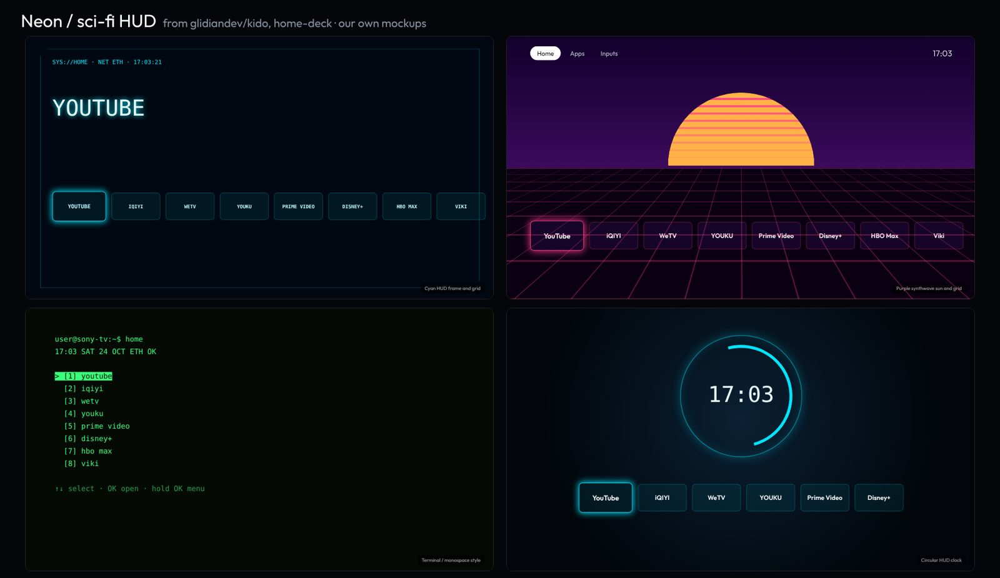

### 6.5 Home guard

| # | Variant |
|---|---|
| 1 | Setting: Home guard switch in Extras |
| 2 | Toast after Home was restored |
| 3 | Prompt when another app (or a TV update) takes Home |
| 4 | Status page: when Home was last restored |

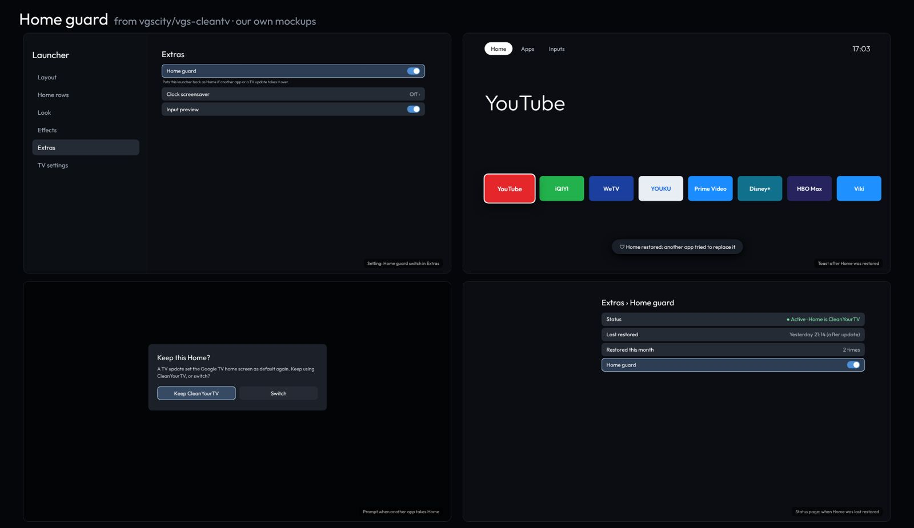

### 6.6 IP-camera tile (needs network)

| # | Variant |
|---|---|
| 1 | One live camera tile in the apps row |
| 2 | 2×2 camera tile next to the apps |
| 3 | Camera view as the Home banner |
| 4 | Settings: camera stream addresses |

Note: your NVR is already on HDMI 2, so the **Input preview** window (v7+) shows the same cameras without any
network access.

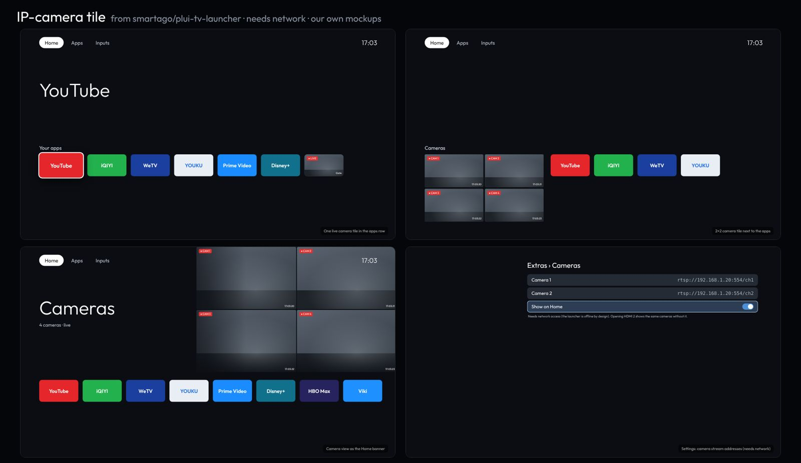

---

## 7. Plan and phases

Each phase ends with one APK to install and test on the TV.

| Phase | Scope | Main files | Test on TV |
|---|---|---|---|
| 0 | Settings redesign (two panels, choice pages, Glow merge); wallpaper quality (High colour, re-rendered scenes) | `LauncherSettingsActivity`, new layouts, `Config`, `themes/scenes/wallpapers` | Every setting still works; Back lands on the right row; wallpapers smooth |
| 1 | Google TV skeleton: redirect, tabs, banner (glow), Your apps + Other apps rows, Apps tab, hold-OK menu | new `GtvActivity`, shared `AppCatalog` | Switch layouts both ways; Home key; open apps |
| 2 | Inputs row and tab, Wallpaper banner, side rail, Posters and Minimal styles | `GtvActivity`, shared `Inputs` | HDMI opens full screen; each style |
| 3 | Continue watching test | `GtvActivity` | Row shows or hides with reason |
| 4 | Polish: D-pad edges, Hebrew layout/strings, README, CI tests | `layout-iw`, `values-iw`, docs | `python3 -m unittest`, CI |
| 5 | Effects: Ribbon, focus styles, focus extras, background motion, transitions, dim when idle | `MainActivity`/`GtvActivity`, `GlowStyle` | Each option; smoothness |
| 6 | Wallpaper sets and options (sets, time of day, blur, USB); online wallpapers: launcher option A (opt-in) and PC script B | `tools/`, `themes/`, `Config`, `AndroidManifest.xml` (`INTERNET`) | Each set; memory; online Off = no network use |

### 7.1 Risks

| Risk | Impact | Mitigation |
|---|---|---|
| Continue watching blocked on Android 9 | Row unavailable | Auto-hide, clear message |
| Continuous effects (particles, aurora) on a 2020 MediaTek chip | Stutter | Marked "may be slow"; off by default; stop when not on Home |
| APK size (fonts already +430 KB) | Larger download | Keep new assets code-drawn; JPEG quality 95 only where needed |
| Scope growth | Long project | One phase at a time; new ideas go to a later phase |
| Signing key lives in this session | Updates refused if lost | User keeps `cleanyourtv-debug.keystore` |
| Online wallpapers add `INTERNET` | Launcher no longer "no network" | Off by default; downloads only pictures, nothing sent about the TV or its use; offline fallback |
| Picture licences | Some sources forbid redistribution | Never commit downloaded pictures; show credit; verify each source's terms first |

### 7.2 Not recommended

| Item | Reason |
|---|---|
| Weather, Google Photos, IP-camera tile | Need internet for more than pictures; out of scope (daily wallpapers are now covered, opt-in, in 5.5) |
| Replacing the Apple TV layout | Keep as fallback |

---

## 8. Questions for review

| # | Question | Suggested answer |
|---|---|---|
| 1 | Start with Phase 0 (settings + wallpaper quality)? | Yes |
| 2 | Default Banner in the Google TV layout | App name + glow |
| 3 | Effects that run all the time (particles, aurora): include? | Yes, off by default |
| 4 | Which new wallpaper sets first? | Gradients, Thailand, Seasonal |
| 5 | USB-stick wallpapers (needs storage permission)? | Later |
| 6 | Online wallpapers in the launcher (A): accept adding `INTERNET`, Off by default? | Yes, opt-in |
| 7 | Default online source | Wikimedia Commons Picture of the Day |
| 8 | Switch the TV screensaver to Google Backdrop / Ambient now (C)? | Yes, no code needed |
